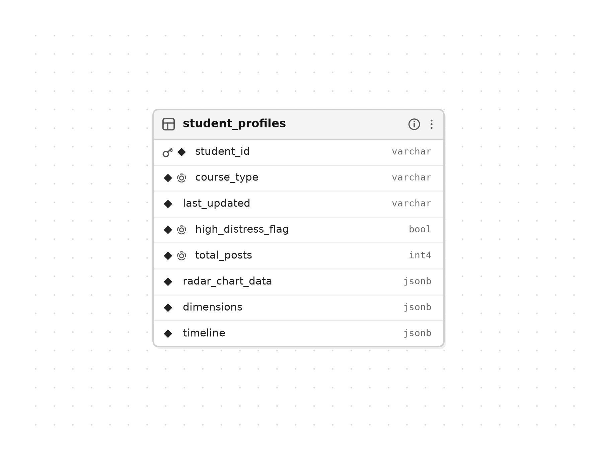
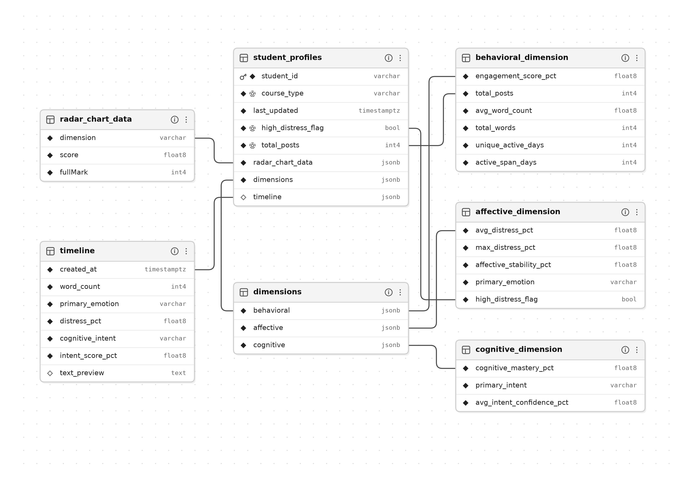

# Student Model — Learning Analytics Dashboard

Plataforma de analítica de aprendizaje que transforma publicaciones de foros educativos en perfiles multidimensionales de estudiantes (**conductual**, **afectivo** y **cognitivo**). Su objetivo es ayudar a docentes y tutores a detectar de forma temprana señales de frustración, confusión o rezago, y entender cómo participa cada estudiante dentro de su curso.

El proyecto procesa el dataset _Stanford MOOC Forum Posts_ (**28,682 publicaciones** limpias correspondientes a **10,924 estudiantes** en cursos de _Education_, _Humanities_ y _Medicine_) y expone los resultados en un panel interactivo conectado a una API en FastAPI y PostgreSQL.

---

## Esquema de Base de Datos

La base de datos vive en **PostgreSQL 15** y utiliza un **diseño híbrido (Relacional + `JSONB`)** centrado en la tabla `student_profiles`.

### 1. Esquema físico en PostgreSQL



| Columna              | Tipo      | Índice / Restricción   | Propósito                                                                                        |
| :------------------- | :-------- | :--------------------- | :----------------------------------------------------------------------------------------------- |
| `student_id`         | `varchar` | `PRIMARY KEY` (B-Tree) | Identificador único del estudiante (`forum_uid`).                                                |
| `course_type`        | `varchar` | `INDEX`, `NOT NULL`    | Área del curso (`Education`, `Medicine`, `Humanities`).                                          |
| `last_updated`       | `varchar` | `NOT NULL`             | Fecha ISO-8601 de la última publicación registrada.                                              |
| `high_distress_flag` | `bool`    | `INDEX`, `NOT NULL`    | Bandera de alerta rápida (`true` si el malestar promedio es ≥ 30%).                              |
| `total_posts`        | `int4`    | `INDEX`, `NOT NULL`    | Total de publicaciones del estudiante (clave para ordenar y filtrar actividad).                  |
| `radar_chart_data`   | `jsonb`   | `NOT NULL`             | Los 4 ejes normalizados (0–100%) listos para graficar en el radar.                               |
| `dimensions`         | `jsonb`   | `NOT NULL`             | Métricas agregadas de las dimensiones `behavioral`, `affective` y `cognitive`.                   |
| `timeline`           | `jsonb`   | `NOT NULL`             | Historial cronológico publicación por publicación (emoción, malestar, intención y vista previa). |

### 2. Estructura lógica expandida (`JSONB`)



### ¿Por qué se optó por este diseño?

Al diseñar la base de datos existían dos caminos: normalizar todo en 5 o 6 tablas separadas (`students`, `posts`, `behavioral_metrics`, `affective_metrics`, `cognitive_metrics`, etc.) o aprovechar la capacidad híbrida de PostgreSQL combinando columnas relacionales tradicionales con `JSONB`. Elegimos el **enfoque híbrido** por cuatro razones muy prácticas:

1. **Lo que el docente filtra y ordena todo el tiempo está a la mano e indexado:**
   Cada vez que alguien usa el panel para filtrar por curso (`course_type`), buscar a un alumno (`student_id`), ver alertas (`high_distress_flag`) u ordenar por participación (`total_posts`), PostgreSQL resuelve la consulta usando índices B-Tree clásicos, rápidos y predecibles.
2. **El expediente del estudiante se lee completo y sin `JOIN` costosos:**
   En este sistema los datos se procesan por lotes con modelos de lenguaje y luego se consultan intensivamente desde el dashboard. Guardar `dimensions`, `radar_chart_data` y `timeline` en `JSONB` evita unir media docena de tablas cada vez que un docente abre la ficha de un estudiante: toda su radiografía vive en una sola fila lista para servirse por la API.
3. **Las tablas grandes se mantienen ligeras cargando el historial bajo demanda:**
   La columna `timeline` puede crecer bastante en estudiantes muy participativos. Cuando el dashboard solicita el listado paginado (`GET /api/students`), el backend usa carga diferida (`defer(StudentProfile.timeline)`) para que PostgreSQL ni siquiera lea ni transfiera ese bloque pesado hasta que el usuario abre el detalle de un estudiante específico (`GET /api/students/{student_id}`).
4. **Flexibilidad analítica sin sacrificar SQL:**
   Si mañana el pipeline agrega nuevas métricas emocionales o ajusta la taxonomía pedagógica (como ocurrió al migrar a _Community of Inquiry_), la estructura interna evoluciona sin migraciones complejas. Al mismo tiempo, `JSONB` permite que PostgreSQL haga agregaciones y filtros directamente sobre campos anidados (como `avg_distress_pct`, `primary_emotion` o `primary_intent` en `/api/analytics`).

---

## Modelos Utilizados y Marco Pedagógico

El perfil de cada estudiante se construye en `backend/pipeline.py` en tres etapas (limpieza, inferencia NLP por lotes y agregación multidimensional) combinando **dos modelos preentrenados de Hugging Face** y **un modelo estadístico de participación**:

### 1. Dimensión Afectiva — [`SamLowe/roberta-base-go_emotions`](https://huggingface.co/SamLowe/roberta-base-go_emotions)

- **Qué hace:** Modelo RoBERTa entrenado en el conjunto _GoEmotions_ para clasificación multietiqueta en **28 emociones**.
- **Cómo se usa en el proyecto:** Analiza cada publicación para identificar la emoción predominante (`primary_emotion`) y calcular un porcentaje de malestar (`distress_pct`, de `0%` a `100%`) sumando las probabilidades de 11 señales de malestar o fricción: `confusion`, `annoyance`, `disappointment`, `nervousness`, `fear`, `sadness`, `anger`, `embarrassment`, `disapproval`, `remorse` y `grief`.
- **Traducción pedagógica en el dashboard:**
  - **Estabilidad afectiva:** `100 - avg_distress_pct`.
  - **Sin alerta (`safe`):** malestar promedio menor a `15%`.
  - **Seguimiento preventivo (`caution`):** malestar promedio entre `15%` y `29.9%`.
  - **Requiere apoyo (`risk`):** malestar promedio de `30%` o más (`high_distress_flag = true`).

### 2. Dimensión Cognitiva — [`MoritzLaurer/DeBERTa-v3-base-mnli-fever-anli`](https://huggingface.co/MoritzLaurer/DeBERTa-v3-base-mnli-fever-anli)

- **Qué hace:** Modelo DeBERTa-v3 especializado en inferencia de lenguaje natural (NLI) usado en modo **Zero-Shot Classification** (sin necesidad de reentrenamiento supervisado para el foro).
- **Cómo se usa en el proyecto:** Evalúa cada mensaje bajo la hipótesis `"In this course forum post, the student is {}."` para clasificarlo según la taxonomía de **Presencia Cognitiva del marco _Community of Inquiry_ (CoI, de Garrison)**.
- **Escala de profundidad cognitiva (`cognitive_mastery_pct`):**

| Categoría CoI               | Qué representa                                                                  | Peso  |
| :-------------------------- | :------------------------------------------------------------------------------ | :---: |
| `Course Logistics & Social` | Reporte de problemas técnicos, fechas límite, saludos o agradecimientos.        | `30`  |
| `Triggering (Questioning)`  | Preguntas, dudas, expresión de confusión o solicitud de ayuda.                  | `45`  |
| `Exploration (Discussion)`  | Opiniones personales, reflexiones y lluvia de ideas sobre el tema.              | `75`  |
| `Integration (Synthesis)`   | Explicación de soluciones, conexión de conceptos con evidencia o apoyo a pares. | `100` |

### 3. Dimensión Conductual — Índice Normalizado por Cohorte

- **Qué hace:** Mide el nivel de participación y constancia (`engagement_score_pct`, de `0%` a `100%`) comparando a cada estudiante únicamente frente a compañeros de su mismo tipo de curso (_Education_, _Medicine_ o _Humanities_) mediante rangos percentiles.
- **Fórmula ponderada:**
  - **45%** percentil del total de publicaciones (`total_posts`)
  - **35%** percentil del promedio de palabras por publicación (`avg_word_count`)
  - **20%** percentil de días únicos con actividad (`unique_active_days`)

> **Nota práctica:** Los perfiles ya vienen precalculados en `backend/student_profiles.json` y se cargan automáticamente en PostgreSQL al arrancar la aplicación. No necesitas GPU ni volver a ejecutar los modelos para correr el proyecto.

---

## Stack Tecnológico

| Capa                     | Tecnologías                                                                                                                                       |
| :----------------------- | :------------------------------------------------------------------------------------------------------------------------------------------------ |
| **Frontend**             | React 19, TypeScript, Vite 8, Tailwind CSS v4 (`@tailwindcss/vite`), Lucide React, gráficos SVG propios (`SpiderChart`, `TimelineChart`), `pnpm`. |
| **Backend**              | Python 3.10, FastAPI, Uvicorn, SQLAlchemy 2.0, Pydantic v2, `psycopg2-binary`.                                                                    |
| **Base de Datos**        | PostgreSQL 15 (`postgres:15-alpine`) con esquema híbrido Relacional + `JSONB`.                                                                    |
| **Pipeline NLP y Datos** | PyTorch (soporte automático para NVIDIA CUDA, Apple Silicon MPS y CPU), Hugging Face `transformers`, `pandas`, `openpyxl`, `tqdm`.                |
| **Infraestructura**      | Docker y Docker Compose (3 servicios orquestados con hot-reload para desarrollo).                                                                 |

---

## Cómo Empezar a Correr el Proyecto con Docker

### Requisitos previos

- [Docker](https://docs.docker.com/get-docker/) y **Docker Compose** instalados (en macOS y Windows basta con tener Docker Desktop abierto).

### 1. Clonar el repositorio

```bash
git clone https://github.com/mp-projects-lab/student-model.git
cd student-model
```

### 2. Construir y levantar los contenedores

Desde la raíz del proyecto ejecuta:

```bash
docker compose up --build
```

Si prefieres dejarlo corriendo en segundo plano:

```bash
docker compose up --build -d
```

### ¿Qué sucede automáticamente al arrancar?

1. **`db` (PostgreSQL 15):** Inicia la base de datos en el puerto `5432` con un volumen persistente (`db_data`) y espera a pasar su `healthcheck` (`pg_isready`).
2. **`api-backend` (FastAPI):** Se inicia cuando PostgreSQL está listo. Al arrancar, `seed_database()` crea la tabla `student_profiles` si no existe y vuelca automáticamente los **10,924 perfiles** desde `backend/student_profiles.json`.
3. **`ui-frontend` (React + Vite):** Levanta el servidor de desarrollo en el puerto `5173` conectado a `http://localhost:8000`.

### 3. Abrir la aplicación

- **Dashboard (Frontend):** http://localhost:5173
- **API Backend:** http://localhost:8000
- **Documentación interactiva (Swagger / OpenAPI):** http://localhost:8000/docs
- **PostgreSQL:** `localhost:5432` (BD: `mydatabase`, usuario: `myuser`, contraseña: `mypassword`)

### Comandos útiles de Docker

```bash
# Ver logs en tiempo real de todos los servicios
docker compose logs -f

# Ver solo los logs del backend (incluye el estado del volcado inicial a PostgreSQL)
docker compose logs -f api-backend

# Detener los contenedores conservando los datos de PostgreSQL
docker compose down

# Detener y borrar el volumen de PostgreSQL (útil para forzar un volcado limpio desde cero)
docker compose down -v
```

### (Opcional) Re-ejecutar el pipeline de NLP

No es necesario para usar la aplicación, pero si deseas regenerar `student_profiles.json` a partir de `backend/stanfordMOOCForumPostsSet.xlsx` (requiere instalar `torch`, `transformers`, `tqdm`, `pandas` y `openpyxl` en tu entorno local):

```bash
cd backend
python pipeline.py
```

Al reiniciar el contenedor `api-backend` tras un `docker compose down -v`, los nuevos perfiles se cargarán automáticamente en PostgreSQL.

---

## Endpoints Principales de la API

| Método | Ruta                         | Descripción                                                                                                                                       |
| :----- | :--------------------------- | :------------------------------------------------------------------------------------------------------------------------------------------------ |
| `GET`  | `/`                          | Comprueba el estado del servicio y la conexión con PostgreSQL.                                                                                    |
| `GET`  | `/api/summary`               | Resumen global de estudiantes, alertas de malestar alto y conteo por curso.                                                                       |
| `GET`  | `/api/analytics`             | Métricas agregadas por curso (o globales): distribución de riesgo, promedios de radar, top 5 emociones e intenciones CoI.                         |
| `GET`  | `/api/students`              | Listado paginado con filtros por curso, estado (`risk`, `caution`, `safe`), intención cognitiva, mínimo de posts, búsqueda por ID y ordenamiento. |
| `GET`  | `/api/students/{student_id}` | Expediente completo de un estudiante, incluyendo sus tres dimensiones, datos de radar y `timeline` cronológico.                                   |

---

## Estructura del Proyecto

```text
student-model/
├── docker-compose.yml              # Orquestación de PostgreSQL, FastAPI y Vite
├── backend/
│   ├── Dockerfile                  # Imagen Python 3.10 + Uvicorn
│   ├── main.py                     # API FastAPI y volcado inicial (seed_database)
│   ├── database.py                 # Conexión y sesiones SQLAlchemy 2.0
│   ├── models.py                   # Modelo ORM StudentProfile (Relacional + JSONB)
│   ├── schemas.py                  # Esquemas de respuesta Pydantic
│   ├── pipeline.py                 # Pipeline NLP (RoBERTa + DeBERTa-v3 + CoI)
│   ├── student_profiles.json       # Perfiles preprocesados listos para poblar la BD
│   └── docs/images/                # Diagramas del esquema de base de datos
└── frontend/
    ├── Dockerfile                  # Imagen Node 20 + pnpm
    └── src/
        ├── components/             # KPIs, filtros, tabla paginada, modales y gráficos SVG
        ├── hooks/                  # Hooks de consumo de API y debounce
        ├── services/               # Cliente HTTP para el backend
        ├── types/                  # Tipos TypeScript sincronizados con la API
        └── utils/                  # Etiquetas, formateadores y lógica pedagógica
```
